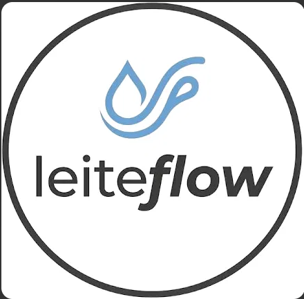

# 🍼 LeiteFlow — Sistema Banco de Leite Humano de Marília

> Plataforma institucional de captação e acolhimento do **Banco de Leite Humano de Marília (HCFAMEMA)**.



## 📌 Sobre o Projeto

O **LeiteFlow** conecta mães doadoras ao Banco de Leite Humano de Marília, organizando a logística de coleta gratuita em domicílio nos bairros da cidade para alimentar recém-nascidos prematuros na UTI Neonatal do HCFAMEMA.

## ✨ Funcionalidades

- **Design Editorial & Orgânico**: Visual acolhedor e profissional em tons de verde sálvia e linho.
- **Totalmente Responsivo**: Otimizado para celular, tablet e desktop com menu hambúrguer e gavetas adaptativas.
- **Área da Doadora (Login)**: Acesso direto para doadoras cadastradas com validação de credenciais.
- **Simulador Interativo de Doação**: Cálculo em tempo real do impacto do leite doado por semana em número de bebês prematuros atendidos.
- **Mapeamento de Rotas de Marília**: Cronograma e cobertura semanal das 5 zonas urbanas (Norte, Sul, Leste, Oeste e Centro).
- **Portal Administrativo Restrito**: Painel institucional seguro para a equipe técnica do BLH.
- **Perguntas Frequentes**: Acordeão interativo para esclarecer as principais dúvidas sobre doação.

## 🛠️ Tecnologias Utilizadas

- **React 18**
- **Vite**
- **Tailwind CSS**
- **Lucide React** (Ícones)

## 🚀 Como Executar Localmente

1. Clone o repositório:
   ```bash
   git clone https://github.com/viniciusfachini2008-hash/LEITE-FLOW-sistema.git
   ```

2. Acesse a pasta:
   ```bash
   cd LEITE-FLOW-sistema
   ```

3. Instale as dependências:
   ```bash
   npm install
   ```

4. Inicie o servidor de desenvolvimento:
   ```bash
   npm run dev
   ```

5. Abra no navegador:
   ```
   http://localhost:3000
   ```

## 🏥 Parceria & Apoio

- **Banco de Leite Humano de Marília**
- **HCFAMEMA** — Hospital das Clínicas da Faculdade de Medicina de Marília
- **Endereço**: Rua XV de Novembro, 50 - Centro, Marília - SP
- **Telefone**: (14) 3413-8696
